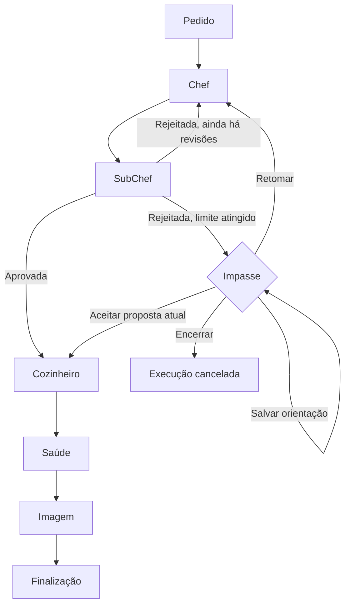

# Coxinh.IA

<p align="center">
  
</p>

**O melhor harness de IA para as coxinhas mais sem sentido que você possa imaginar.**

O Coxinh.IA transforma ingredientes e ideias improváveis em receitas de coxinha. É um projeto de humor e sátira criado para estudar fluxos com agentes de IA: a receita pode ser absurda, mas o sistema precisa mostrar como chegou ao resultado e apresentar o aconselhamento de consumo com suas fontes e incertezas.

**Estado atual:** API oficial em `src/api/app.py`, interface React com polling e carrossel global, persistência em SQLite ou Postgres e imagens via OpenRouter (ou simulação sem chave).

## Rodar localmente

### Pré-requisitos

- Python 3.11 ou superior.
- Node.js 24.
- Chaves de provedor para gerar receitas e, se desejado, consultar a web e gerar imagens reais.

### 1. Configurar o ambiente

Na raiz do projeto, crie o ambiente Python, instale as dependências e copie o arquivo de configuração:

```powershell
py -3 -m venv .venv
.\.venv\Scripts\Activate.ps1
python -m pip install -e ".[dev]"
if (-not (Test-Path .env)) { Copy-Item .env.example .env }
notepad .env
```

Preencha as variáveis necessárias no `.env`:

| Variável | Quando usar |
| --- | --- |
| `LLM_PROVIDER`, `LLM_MODEL` | Obrigatórias. Escolha `google` ou `groq` e informe o modelo. |
| `GOOGLE_API_KEY` ou `LLM_KEY` | Obrigatória. Use a chave correspondente ao provedor escolhido. |
| `TAVILY_API_KEY` | Recomendada para a pesquisa do agente de saúde. Sem ela, o aconselhamento fica indisponível. |
| `OPENROUTER_API_KEY` | Opcional. Habilita geração de imagem real; sem ela, o provedor simulado é usado. |
| `LANGFUSE_*`, `LANGSMITH_*` | Opcionais. Habilitam rastreamento. |

Não envie o `.env` ao Git. Os valores de banco, MCP e imagem usados pelo Docker já estão definidos no `compose.yaml`.

### 2. Instalar o frontend

Em um terminal PowerShell, a partir da raiz:

```powershell
Set-Location -LiteralPath .\frontend
npm.cmd ci
```

Se o Vite já estiver aberto, pare-o com `Ctrl+C` antes de reinstalar dependências.

### 3. Iniciar a API e a interface

Abra dois terminais PowerShell. No primeiro, a partir da raiz do projeto, inicie a API:

```powershell
.\.venv\Scripts\Activate.ps1
uvicorn src.api.app:create_app --factory --host 127.0.0.1 --port 8081
```

No segundo, também a partir da raiz, inicie o frontend:

```powershell
Set-Location -LiteralPath .\frontend
npm.cmd run dev -- --host 127.0.0.1
```

Abra o endereço informado pelo Vite, normalmente `http://127.0.0.1:5173`. A API usa a porta `8081`; se ela já estiver ocupada pela própria API, reutilize a instância existente em vez de iniciar outra. Para usar outra porta, ajuste também o destino do proxy do frontend.

## Rodar com Docker

Com o Docker Desktop aberto e o `.env` configurado na raiz, suba os serviços:

```powershell
docker compose up --build -d
docker compose ps
```

Abra `http://127.0.0.1:3000`.

| Serviço | Endereço | Função |
| --- | --- | --- |
| `front` | `http://127.0.0.1:3000` | Interface React servida pelo Nginx. |
| `api` | `http://127.0.0.1:8080` | API FastAPI. A documentação fica em `/docs`. |
| `mcp` | Rede interna `mcp:8000` | Ferramentas MCP de validação e geração de imagem. |

Comandos úteis:

```powershell
docker compose up -d
docker compose logs -f api
docker compose down
```

Se alterar o `.env`, rode `docker compose down` e depois `docker compose up -d` para recriar os serviços com as novas configurações. `docker compose down -v` apaga o volume `coxinh-postgres`, incluindo receitas, impasses e imagens. Use-o somente se quiser apagar esses dados. As portas `3000` e `8080` precisam estar livres no computador.

## Como o sistema funciona

1. **Chef:** propõe uma receita estruturada a partir da ideia enviada.
2. **SubChef:** revisa a proposta. Se rejeitar, o Chef tenta novamente, respeitando o limite de revisões.
3. **Impasse:** pausa a execução se o limite for atingido. A pessoa pode salvar orientações, retomar, aceitar a proposta atual ou encerrar.
4. **Cozinheiro:** organiza a receita em título, subtítulo, ingredientes e passos, sem substituir os ingredientes por conta própria.
5. **Saúde:** pesquisa massa, recheio e preparo na web e apresenta um aconselhamento informativo, com fontes e incerteza quando cabível. Não altera nem aprova a receita.
6. **Imagem:** usa OpenRouter quando configurado. Sem a chave, o provedor simulado é usado. Uma falha de imagem não impede a finalização.
7. **Finalização:** reúne receita, aconselhamento e estado da imagem em `final_response`.



O grafo está em [`src/graph/builder.py`](./src/graph/builder.py). No Docker, receitas, decisões do Impasse, checkpoints e imagens ficam no Postgres do serviço `db` (volume `coxinh-postgres`). Fora do Docker, a API usa SQLite por padrão; para usar Postgres, defina `PERSISTENCE=postgres` e `DATABASE_URL`.

### Exemplo de uma execução com Impasse

O resultado varia conforme o modelo usado. Este exemplo mostra a sequência possível:

| Passo | O que acontece | Estado |
| --- | --- | --- |
| 1 | A pessoa envia ingredientes e modo de preparo. | `running` |
| 2 | Chef propõe uma receita e SubChef a revisa. | `running` |
| 3 | A proposta é rejeitada até o limite de revisões. | `awaiting_user` |
| 4 | A pessoa salva ingredientes ou orientações. A execução continua pausada. | `awaiting_user` |
| 5 | A pessoa retoma; Chef tenta novamente com as orientações salvas. | `running` |
| 6 | Se aprovada, a receita passa por preparo, saúde, imagem e finalização. | `completed` |

Ao aceitar a proposta atual, o fluxo segue diretamente para o Cozinheiro. Ao encerrar, termina sem uma receita concluída.

## Experimentar o sistema

### Ideias para enviar

| Pedido | Resultado esperado |
| --- | --- |
| `Tenho frango, queijo e mandioca. Quero fritar na panela.` | Geralmente gera receita sem Impasse. |
| `Tenho um sapato velho, um cadarço, meio saco de cimento e um cabo USB. Quero fritar na panela.` | Pode chegar ao Impasse. A resposta depende do modelo e das revisões. |
| Pedido vazio ou só com espaços | A interface pede uma ideia; a API responde 422. |
| Pedido com mais de 4000 caracteres | A API responde 422. |

### Ingredientes no Impasse

O campo aceita texto livre. Vírgulas, ponto e vírgula, quebras de linha, a palavra “e” e marcadores de lista separam os itens. A comparação ignora maiúsculas e acentos. Itens que a receita não passou a usar podem fazer a execução voltar ao Impasse com uma explicação.

### Testar o Impasse sem chamadas ao modelo

O modo de demonstração substitui Chef e SubChef por versões fixas que sempre chegam ao Impasse:

```powershell
python -m src.app.main --demo-impasse
```

No terminal, `a` aceita, `s` salva, `r` retoma e `c` cancela.

## API e persistência

A API é a entrada HTTP usada pelo frontend. O contrato detalhado está em [`docs/CONTRATO_API.md`](./docs/CONTRATO_API.md). Com a API Docker ativa, consulte a documentação em `http://127.0.0.1:8080/docs`; na execução local, consulte `http://127.0.0.1:8081/docs`.

Principais operações:

| Operação | Uso |
| --- | --- |
| `POST /recipes` | Inicia a criação de uma receita. |
| `GET /recipes` | Lista receitas para o carrossel global. |
| `GET /recipes/{thread_id}` | Consulta uma execução ou seus detalhes. |
| `POST /recipes/{thread_id}/impasse` | Salva orientação, retoma, aceita ou encerra uma execução pausada. |
| `GET /images/{filename}` | Busca uma imagem armazenada. |

O histórico global fica no banco (Postgres no Docker, SQLite por padrão fora dele). A interface guarda o identificador da execução ativa e consulta seu estado por polling. A API deve rodar em um único processo por banco. Impasses em aberto sobrevivem a reinícios; uma geração interrompida pode precisar ser refeita.

## Testes

Os testes usam integrações simuladas e não fazem chamadas pagas. A partir da raiz:

```powershell
python -m pytest -q
Set-Location -LiteralPath .\frontend
npm.cmd run build
npm.cmd run lint
npm.cmd test
```

Para executar verificações específicas do Impasse ou da recuperação após queda:

```powershell
python -m pytest -q tests/test_impasse_recovery.py
python -m pytest -q tests/test_crash_recovery.py
```

Os testes de navegador usam Microsoft Edge, portas isoladas e agentes externos simulados. Para atualizar as capturas visuais, execute `npm.cmd run test:visual` na pasta `frontend`.

## LangGraph Studio e LangSmith

O Studio permite inspecionar os nós do grafo, o estado de cada etapa e retomar um Impasse manualmente. Na raiz do projeto:

```powershell
python -m pip install "langgraph-cli[inmem]"
langgraph dev --no-browser --no-reload --port 2024
```

O endereço do Studio aparece no terminal. Para enviar rastros ao LangSmith, configure `LANGSMITH_TRACING=true`, `LANGSMITH_API_KEY` e `LANGSMITH_PROJECT` no `.env`. A pasta `.langgraph_api/` armazena execuções do Studio localmente, separadas do SQLite da aplicação.

No Studio, use o grafo `coxinha` e uma entrada como:

```json
{
  "raw_input": "Tenho um sapato velho, um cadarço e meio saco de cimento. Quero fritar na panela.",
  "thread_id": "teste-1"
}
```

Quando o Impasse pausar, a resposta precisa ser um JSON válido. Uma decisão contém `action`, `expected_state_version` e `idempotency_key`. As ações são `save`, `resume`, `accept` e `cancel`. `save` e `resume` também podem receber `ingredient_additions` e `user_guidance`. Consulte o contrato da API para os exemplos completos.

## Estrutura principal

| Caminho | Função |
| --- | --- |
| `src/schemas.py`, `src/state.py` | Contratos da receita e estado compartilhado do grafo. |
| `src/graph/nodes/`, `src/graph/builder.py` | Agentes, geração da imagem e rotas do fluxo. |
| `src/graph/workflow.py`, `src/recipe_session.py` | Checkpoints, retomada do Impasse e histórico. |
| `src/api/app.py` | API FastAPI usada pelo frontend. |
| `src/persistence/` | SQLite ou Postgres para receitas, decisões, checkpoints e imagens. |
| `src/utils/web_search.py` | Pesquisa Tavily do agente de saúde. |
| `mcp_server/` | Ferramentas MCP de validação e geração de imagem. |
| `frontend/` | Interface React, configuração do Vite e arquivos do Docker. |
| `compose.yaml`, `Dockerfile` | Serviços `front`, `api`, `mcp` e `db` (Postgres) e volume de dados. |
| `tests/` | Testes automatizados. |
| `docs/design/design.md` | Especificação visual da interface. |
| `docs/plano_execucao_coxinh_ia.md` | Etapas e critérios do projeto. |

## Limites e cuidados

- A imagem gerada depende de `OPENROUTER_API_KEY`. Sem a chave, o sistema usa uma referência simulada e não exibe uma imagem real.
- O aconselhamento de saúde é informativo. As fontes ajudam a rastrear a pesquisa, mas não garantem segurança de consumo.
- Uma falha de rede após o envio de um pedido pode impedir que o navegador receba o identificador da execução. A interface consulta o histórico e não repete o envio automaticamente.
- O projeto usa um único processo de API por banco.

## Projeto

Desenvolvido por João Santos e Caio Brayner para praticar engenharia de IA durante o bootcamp da Deloitte. A ideia nasceu de uma piada da turma sobre a coxinha da padaria do Moinho e da brincadeira da dupla de transformar qualquer ideia em um sistema de IA. A identidade e as decisões visuais estão em [`docs/design/design.md`](./docs/design/design.md).
